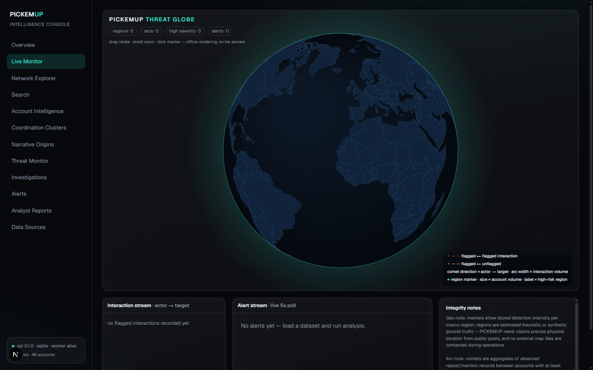
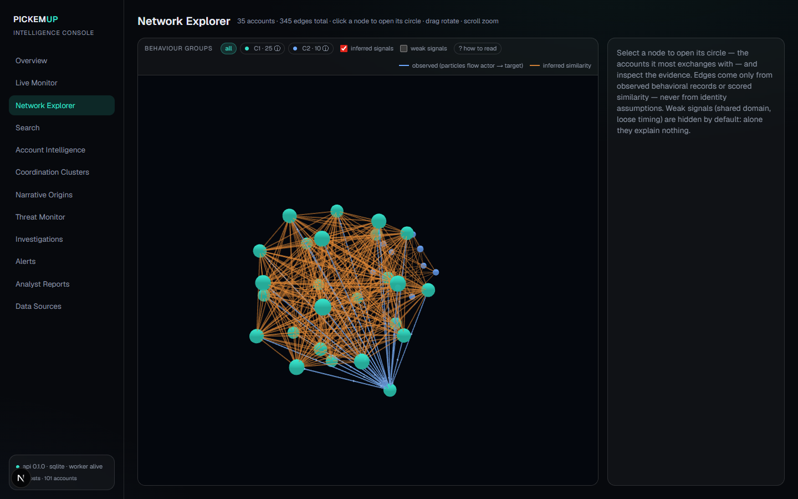
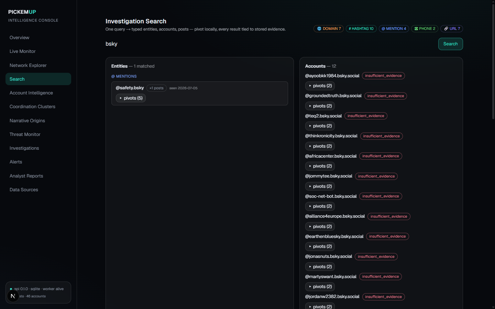
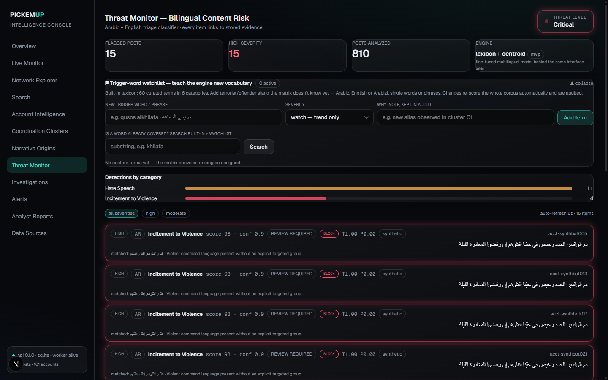
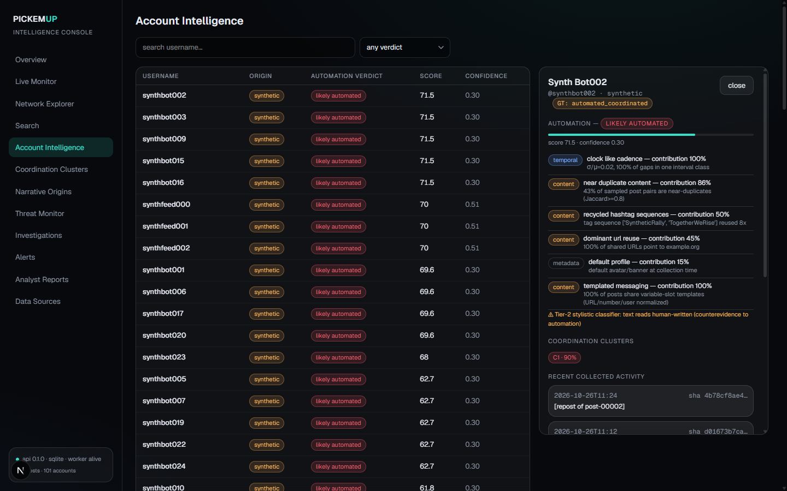
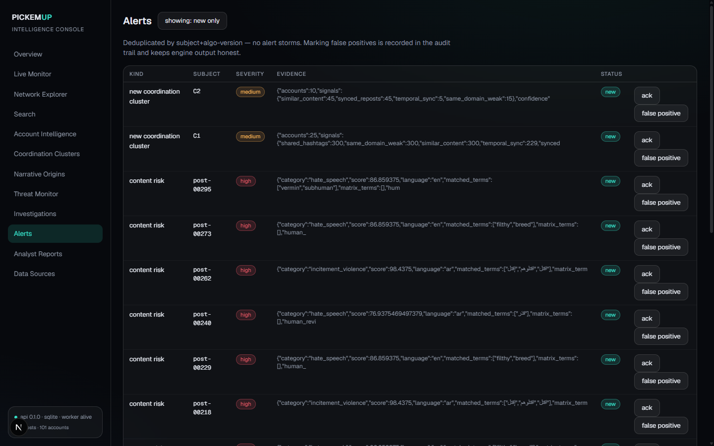
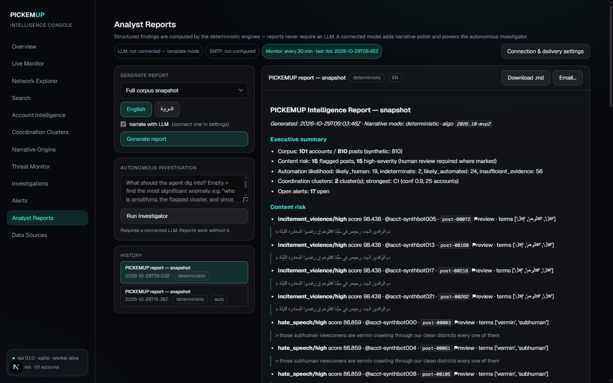
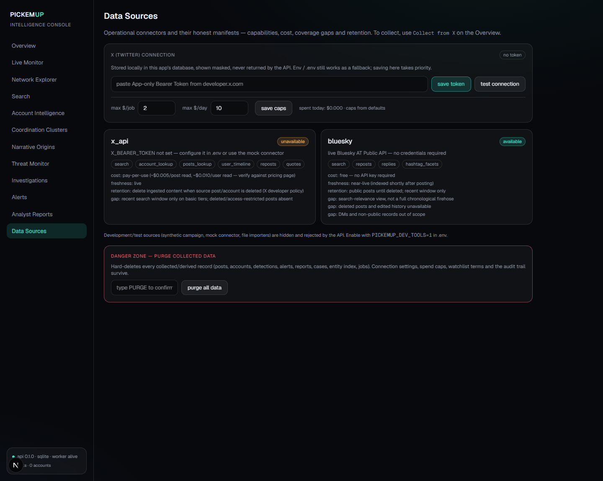

# PICKEMUP — Local-first OSINT & Coordinated-Network Intelligence

**See the puppeteers, not just the puppets.**

PICKEMUP collects public posts from **Bluesky** and **X**, scores suspicious automation and
coordination with **explainable deterministic engines**, reconstructs narrative origins, and
stores every finding as searchable local evidence — each verdict linked back to the exact posts
that produced it.

✓ 127 automated tests · ✓ Free Bluesky path — no API key needed · ✓ 100% local (SQLite / Postgres)
· ✓ Works fully without any LLM · ✓ Bilingual AR + EN risk engine · ✓ Provenance & audit built-in


> A styled one-page explainer lives at [`docs/github/index.html`](docs/github/index.html) —
> publish it with GitHub Pages for the scroll-tour version of this README.

## Built for investigators, not dashboards-for-the-sake-of-it

- 🕵 **Every number is re-verifiable.** All stats are computed from records *you* collected.
  Nothing phones home, nothing is a black box: verdicts say *likely automated*, never
  *proof of bot*.
- 🧠 **The engines are the brain.** Automation scoring, coordination clustering, risk lexicons
  (Arabic · English · Arabizi), narrative origin tracking and a typed entity index run
  deterministically, offline. An LLM is an *optional* narration layer — the product's integrity
  never depends on it.
- 🗄 **A case file you can search years later.** One SQLite file holds posts, accounts, findings,
  entities, alerts, cases, reports and an append-only audit log. Full-text and typed-entity
  search with pivots works on the local corpus forever.
- 💸 **Paid-API paranoia included.** The X connector refuses to spend beyond your caps —
  estimated *before* every HTTP call, per-job and per-day, with a live counter in the UI.
  A zero-record run always explains itself.

## Product tour

Screens below were captured from a **live Bluesky corpus** collected with one click and zero
credentials — exactly what you get on first run. Synthetic demo data, when used, is always
visibly badged *synthetic* — that honesty is the point.



**Live Monitor — threat globe.** Starfield globe with region risk markers and directed comet
arcs built from *real repost/mention records* crossing regions. Arc width = interaction volume;
color = whether both endpoints are flagged. Offline rendering — no tile servers, no external calls.



**Network Explorer — coordination graph.** 3D force graph of accounts and edges. Blue = observed
interactions (reposts/mentions; particles flow actor → target); orange = inferred behavioral
similarity. Weak signals are suppressed by default; click a node to open its ego-circle with
evidence. Edges come only from observed records or scored similarity — never from identity
assumptions.



**Investigation Search.** One query returns typed entities (domains, hashtags, mentions, URLs,
phones, emails), matching posts and accounts — with *pivots*: who posted this, what else
co-occurs.



**Threat Monitor + watchlist.** Bilingual risk triage with category/severity/action per post —
and the operator *watchlist*: teach the engine your own trigger words; the whole corpus
re-scores automatically and new hits alert. Flagged items carry an `investigate →` action into
the human-review queue.



**Account Intelligence dossier.** Full verdict with per-signal contributions (clock-like cadence,
near-duplicate content, recycled hashtag sequences, templated messaging…), *counter-evidence*
when signals disagree, cluster membership, and the raw evidence trail with content hashes.



**Alerts.** Deduplicated, triageable: new / acknowledged / false-positive. Escalations come from
automation verdict changes, new clusters, watchlist hits, collection bursts and engine
correlations.



**Analyst Reports.** Deterministic EN/AR reports built from a stored fact-pack with a SHA-256
fingerprint — any claim can be re-audited against evidence. Optional LLM narration; optional
email delivery with full audit.



**Data Sources — operator controls.** Bearer token save/clear/test (masked, never echoed by the
API), spend caps, and a confirm-typed `PURGE` for wiping collected data while keeping settings,
watchlist vocabulary and the audit trail.

## How it works

Four stages, one durable pipeline. Every stage is a queue job — atomic claims, retries,
dead-letter, all inspectable in the UI.

1. **Collect** — Bluesky public search (free, no key) · X API v2 recent search (App-only bearer) ·
   BudgetGuard estimates cost *before* each call with hard per-job & per-day caps ·
   rate-limit aware; errors translated to plain language.
2. **Store** — posts + accounts with provenance JSON & SHA-256 · `origin_mode`
   (live · fixture · mock · synthetic) badged in the UI · dedup, typed entity index,
   append-only audit log.
3. **Analyze** — automation: multi-signal, explainable, ≥2 strong signal families to flag ·
   coordination: synced reposts, temporal-sync of near-duplicates, popular-artifact exclusion ·
   risk: 6-category AR/EN/Arabizi matrix + operator watchlist · narratives: first-observed origin
   tracking, honest about gaps.
4. **Act** — deduped alerts with triage · cases & analyst reports (facts + fingerprint) ·
   optional monitored email delivery, fully audited.

A successful collection **auto-chains the whole engine pipeline** — you never have to remember
to run analysis. The monitor then re-analyzes the stored corpus on a schedule and raises alerts
on deltas.

## Connecting data sources

⚡ **Fastest path: Bluesky — nothing to connect.** `bluesky` uses the public `api.bsky.app`
search API: no key, no billing, available the moment you start the app. Choose
**Bluesky · free** in the Overview collect panel, type a query, done. Honest limits: it's a
search view of public posts (no firehose, no deleted posts), rate-limited politely with
auto-backoff.

### Connecting X

PICKEMUP reads X through the official **API v2** with a single App-only OAuth2 bearer token. It
needs *only* that token — never your password, consumer key or consumer secret. Spend caps
($/job, $/day) are enforced before every HTTP call.

1. **Create the app & get the token** — at [developer.x.com](https://developer.x.com): create a
   project + app, then copy the **Bearer Token** (App-only OAuth2). Reading recent search
   requires a *paid access tier with credits* — the free tier is write-only.
2. **Give PICKEMUP the token** — paste it into **Data Sources → X connection → save token**
   (stored locally, masked everywhere, never returned by any API response), *or* put it in `.env`
   as `X_BEARER_TOKEN=*** UI value wins over env.
3. **Set your money limits** — same card: max $/job and max $/day (defaults $2 / $10). The
   BudgetGuard estimates each page pull and refuses calls that would exceed caps — *before*
   making them. A live "spent today" counter tracks actuals.
4. **Test, then collect** — click **test connection** (one cheap authenticated call that tells
   you exactly where you stand), then start a recent-search query from the Overview.

| Probe / job says | Meaning | Fix |
|---|---|---|
| `402 — NO CREDITS` | Token valid; project has no paid credits | Top up at developer.x.com → Billing |
| `401 — token invalid` | Token revoked or mistyped | Regenerate and re-save |
| `403 — not permitted` | Your tier doesn't include this endpoint | Check the product's access level |
| `429 — rate limited` | Too many calls | Nothing — the connector auto-waits until reset |

Recent-search reaches ~7 days back, and deleted/edited posts are gone — connector manifests
state their own coverage gaps on the Data Sources page so nobody over-trusts a null result.

## Optional intelligence layer (off by default)

Point PICKEMUP at any OpenAI-compatible endpoint (including a fully local model) and two things
unlock — without ever weakening the deterministic core:

- 📝 **Narrative reports** — the engine still compiles the facts; the model only *writes* around
  them. The fact-pack + SHA-256 fingerprint is stored with every report; if the model misbehaves,
  the template report is produced automatically and the failure is logged.
- 🔎 **Autonomous investigator** — an agent over seven *read-only* tools (risk lists, cluster
  detail, account dossier, search, entity pivots…) that drafts findings, each cited to stored
  evidence ids. It cannot collect, delete, or send anything.

Delivery policy: copies to the operator are mandatory and logged; email to *authorities* is
opt-in per report and audited (recipient, time, SHA of content). SMTP + model secrets are
write-only, like the X token.

## Privacy, honesty & misuse

- 🔒 **Local-first by construction.** The database is a file on your disk. The only outbound
  calls are the Bluesky public API / X API (with your token), an optional LLM endpoint you
  configure, and optional SMTP. No telemetry, no SaaS, no phoning home.
- 🏷 **Badge what's synthetic.** Every record carries an origin mode; demo, mock and fixture data
  are visibly badged throughout the UI. Synthetic-data metrics are never presented as
  live-network accuracy.
- 🗣 **Verdicts stay probabilistic.** Output language is capped at *likely / possible /
  indeterminate / insufficient evidence*. The product never asserts identity, control, or
  authorship from correlation, and reports organic alternative explanations alongside findings.
- ⚖ **Use it lawfully.** Built for researching **public** coordinated inauthentic behavior —
  journalism, academia, platform-trust teams, election integrity. Not for harassment, doxxing, or
  surveilling private individuals. Respect platform ToS and applicable law.

## Install & quick start

**① Installer (a PC you use)** — run `PICKEMUP-Setup-0.1.0.exe` (rebuild anytime with
`scripts\build-installer.bat`). Per-user install — no admin rights. A desktop shortcut starts
everything; the uninstaller asks before ever touching your collected data. Needs Python ≥ 3.11
(and Node ≥ 18 for the dashboard) on the machine once.

**② USB / external drive — nothing installed** — copy the folder to any drive and double-click
`PICKEMUP_PORTABLE.bat` at its root. The venv, `node_modules`, caches and the SQLite case file
all live *on the drive* — no registry writes, no AppData, no admin. Ports via
`PICKEMUP_API_PORT` / `PICKEMUP_WEB_PORT`; on a machine without Node it drops cleanly to
API-only mode.

**③ Manual / development (any OS)** — Python ≥ 3.11, Node ≥ 20:

```bat
git clone https://github.com/RABSTERLAB/PICKEMUP.git && cd PICKEMUP
scripts\bootstrap.bat              :: venv + deps (uv recommended)
copy .env.example .env             :: optional: X_BEARER_TOKEN + spend caps
scripts\START_PICKEMUP.bat         :: one click: API + dashboard + browser
                                     (or scripts\dev-all.bat)

:: verify
.venv\Scripts\python -m pytest tests -q        :: 127 tests
.venv\Scripts\python scripts\e2e_demo.py       :: full acceptance scenario
```

Open **http://localhost:3000** and collect from **Bluesky (free, no setup)** immediately — or
point the panel at X with a funded token. Flagged posts carry an `investigate →` action that
enrolls them in the human-review queue for extraction and reporting. The labeled offline demo
remains available for development (`PICKEMUP_DEV_TOOLS=1`).

## Repo layout

`apps/web` Next.js dashboard · `services/api` FastAPI + durable worker ·
`packages/analysis-core` engines · `packages/connectors` ingestion · `docs/` architecture &
GitHub Pages explainer · `packaging/` installer definition.

Architecture: [`docs/architecture/SYSTEM_ARCHITECTURE.md`](docs/architecture/SYSTEM_ARCHITECTURE.md) — measure engine quality anytime with `python scripts/evaluate_demo.py`.

## License

Released under the [MIT License](LICENSE).
