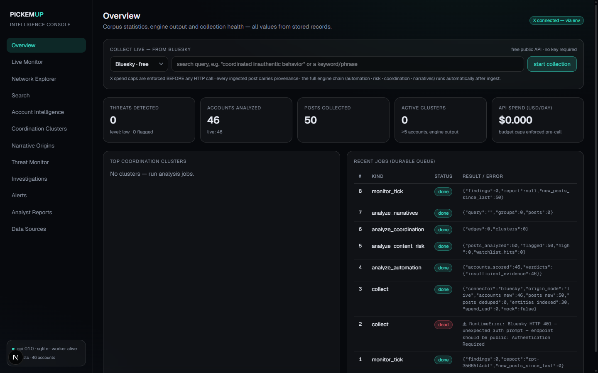

# PICKEM**UP**

**Local-first OSINT & coordinated-network intelligence.** Collects public posts from X,
scores suspicious automation and coordination with explainable deterministic engines,
reconstructs narrative origins, and stores every finding as searchable local evidence —
each verdict linked to the exact posts behind it. Fully functional without any LLM.



**Full documentation & product tour:** [`docs/github/index.html`](docs/github/index.html) —
how it works, screenshot tour, X API connection guide, privacy & ethics.

## Highlights

- ⚡ **Two live connectors** — Bluesky (free public API, zero setup) and X API v2 (paid, spend-capped)
- 🌐 **Live Monitor** — starfield threat globe; directed comet arcs from real repost/mention records
- 🕸 **Network Explorer** — 3D coordination graph; observed vs inferred edges; ego-circle drill-down
- 🔎 **Investigation Search** — typed entity index (domains, phones, emails, hashtags…) with typed pivots
- 🗣 **Bilingual risk engine** — Arabic · English · Arabizi lexicon matrix + operator-extensible watchlist
- 🤖 **Automation scoring** — explainable per-signal contributions with counter-evidence, never black-box
- 📝 **Analyst reports** — deterministic EN/AR fact-packs with SHA-256 fingerprints; optional LLM narration
- 💸 **Paid-API paranoia** — spend caps enforced *before* every HTTP call; zero-hauls always explain themselves
- 🗄 **One local case file** — SQLite (Postgres on roadmap): posts, findings, alerts, cases, append-only audit log

## Quick start

**Fastest (Windows):** double-click **`scripts\START_PICKEMUP.bat`** — bootstraps anything missing,
starts API + dashboard, opens the browser.

**Portable / USB:** double-click **`PICKEMUP_PORTABLE.bat`** at the repo root. It runs the whole
product from wherever the folder lives (external SSD, USB stick): venv, `node_modules`, caches and
the SQLite database are all created **inside the folder** — nothing installs on the host, no
registry, no admin rights. Override ports with `PICKEMUP_API_PORT` / `PICKEMUP_WEB_PORT`.
If the host has no Node.js it cleanly drops to API-only mode (`/docs`). Host needs Python ≥ 3.11
(once, any PC) — everything else travels with the drive.

**Install as a program:** run **`scripts\build-installer.bat`** on a dev machine to produce
`dist\PICKEMUP-Setup-<version>.exe` (Inno Setup; installs per-user, no admin; uninstaller
asks before touching your collected data).

<details>
<summary>Manual / dev setup</summary>

```bat
scripts\bootstrap.bat        :: venv + deps (Python ≥ 3.11, uv recommended)
scripts\dev-all.bat          :: API+worker :8090 · dashboard :3000
```

Open **http://localhost:3000** → choose **Bluesky · free** (no key, no billing) in the collect panel →
real posts in seconds. For X, save your bearer token on **Data Sources** (or `.env`) — spend caps enforced pre-call.

```bat
.venv\Scripts\python -m pytest tests -q      :: full test suite
.venv\Scripts\python scripts\e2e_demo.py     :: acceptance scenario
```
</details>

## Connecting X

One App-only OAuth2 **bearer token** from [developer.x.com](https://developer.x.com) — never your
password or consumer secret. Reads require a paid tier with credits; spend caps ($/job, $/day) are
enforced pre-call. See the [X API guide section](docs/github/index.html#connectx) for step-by-step
and a troubleshooting table (401/402/403/429).

## What's honest

- Every record carries `origin_mode` (live · fixture · mock · synthetic) — badged in the UI everywhere.
- Verdicts stay probabilistic: `likely_* / possible / indeterminate / insufficient_evidence`.
  The product never asserts identity, control, or authorship from correlation.
- Metrics are validated on labeled synthetic ground truth; no live-network accuracy claims.
- Coverage gaps (7-day recent-search window, deleted posts) are declared in connector manifests.

## Layout

`apps/web` Next.js dashboard · `services/api` FastAPI + durable job queue ·
`packages/analysis-core` engines · `packages/connectors` ingestion ·
`docs/` architecture, research, progress.

Architecture: [`docs/architecture/SYSTEM_ARCHITECTURE.md`](docs/architecture/SYSTEM_ARCHITECTURE.md) - measure engine quality anytime with `python scripts/evaluate_demo.py`.

> Built for researching **public** coordinated inauthentic behavior — journalism, academia,
> platform-trust and election-integrity work. Not for harassment or surveilling private individuals.

## License

Released under the [MIT License](LICENSE).
